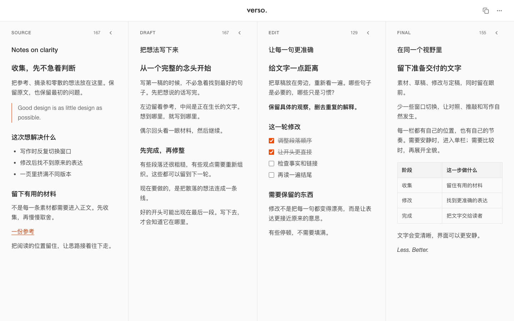

<h1 align="center">verso.</h1>
<p align="center">Less. Better.</p>
<p align="center">一个安静的四栏写作工作台。</p>
<p align="center">
  <a href="https://kanshao2077.github.io/jianbai/">Open verso.</a>
  &nbsp;·&nbsp;
  <a href="docs/images/verso-dark.png">Dark appearance</a>
</p>



素材、草稿、修改与定稿，同时留在眼前。少一些窗口切换，让对照、推敲和写作自然发生。

## A place for every stage

| SOURCE | DRAFT | EDIT | FINAL |
| :--- | :--- | :--- | :--- |
| 收集参考与摘录 | 写下第一版想法 | 对照、修改与整理 | 留下准备交付的文字 |

四栏各有独立标题、字符统计和滚动位置。可以收起暂时不用的栏，也可以进入单栏专注，按 `Esc` 回到完整视野。

## Made for writing

- **Markdown** — 输入或粘贴标题、列表、链接、引用、代码、普通表格和任务清单；复制时保留 Markdown 结构。
- **Local autosave** — 标题和正文自动保存在当前浏览器，无需账号。
- **Quiet focus** — 输入时，其他栏轻微淡出；停笔后恢复。橙色呼吸灯提示正在编辑。
- **Light & dark** — 外观随系统切换，尊重系统的减少动态效果设置。
- **Only what matters** — 顶栏保留复制与更多；菜单提供 `Info`、`Focus`、`Fullscreen` 和 `Reset`。重置需确认，并可通过 `Undo` 恢复。

普通表格可直接粘贴，也可输入表头及分隔行后按 Enter 创建。输入 `- [ ] ` 或 `- [x] ` 创建任务，点击复选框切换状态。复杂表格复制时保留为 HTML，避免丢失结构。

## Your words, saved here

内容只保存在**当前浏览器**的本地存储中，不提供云端同步。换设备或浏览器不会自动带走稿件；清理浏览器数据会移除已保存内容。重要稿件请及时复制到自己的文档中。

已有见白版本的标题与正文沿用原存储键，无需迁移。

## Run locally

使用 Node.js 22。

```bash
npm install --no-package-lock
npm run dev
```

打开终端显示的本地地址。生产构建：

```bash
npm run build
```

输出目录为 `dist/`。仓库已配置 GitHub Pages，推送到 `main` 后自动构建并部署。

---

Made by [Kan Shao 2077](https://github.com/kanshao2077).

最初基于[秒哒导出的项目](https://www.miaoda.cn/projects/app-8cb8oymsg7wh)整理。此前的 README 保存在 [archive](docs/archive/README-before-verso-2026-10-20.md)。
